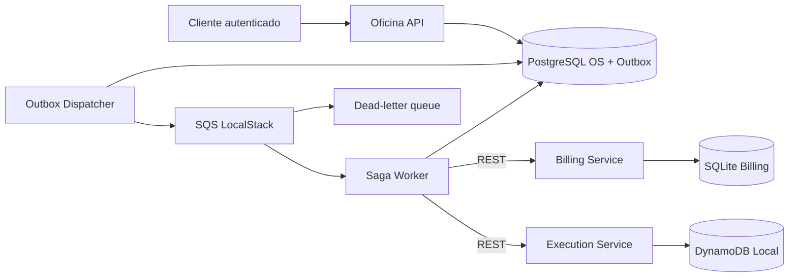

# Arquitetura de referência — Fase 4 (ambiente local)

## Escolha: Saga orquestrada

A orquestração centraliza decisões de transição e compensação no Saga Worker. A publicação via outbox torna a emissão do evento durável no PostgreSQL. A entrega para a fila é *at least once* e, por isso, as transições precisam ser idempotentes. Falhas anteriores ao início da execução acionam compensação de orçamento e item de trabalho; após início, o sistema marca `COMPENSATION_REQUIRED` para intervenção operacional.

## Limites do protótipo

- Aprovação automática do orçamento é apenas uma simulação, não substitui aprovação humana nem confirmação de pagamento Mercado Pago.
- O worker de Saga utiliza REST entre serviços; nenhum microsserviço acessa o banco de outro serviço.
- SQLite no Billing é adequado para a demonstração local, mas exige avaliação de concorrência e disponibilidade para operação distribuída.
- Kubernetes/EKS e credenciais reais não são pré-requisitos para rodar a demonstração local.
- A publicação de eventos de orçamento é automática após `POST /api/v1/orders/{order_id}/request-quote`; a simples criação da OS não gera orçamento porque não informa valor.
