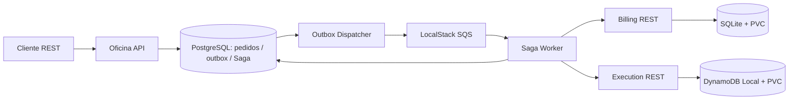

# FIAP Tech Challenge - Fase 4 | Guia de entrega e evidencias

> Ambiente demonstrado: Kubernetes local (kind), LocalStack SQS, PostgreSQL, SQLite persistente no Billing e DynamoDB Local no Execution. Nenhum recurso AWS pago e necessario para reproduzir a demonstracao local.

## Repositorios e branches

| Componente | Repositorio | Branch |
|---|---|---|
| API / Outbox / Saga | https://github.com/YasminLuna/oficina-api | feature/fase4-microservices |
| Billing | https://github.com/YasminLuna/oficina-billing-service | feature/fase4-service |
| Execution | https://github.com/YasminLuna/oficina-execution-service | feature/fase4-service |

## Arquitetura demonstrada



O orquestrador e o dispatcher sao processos independentes da API, mas utilizam codigo do repositorio da API. A persistencia dos servicos e separada no ambiente local.

## Evidencias de testes observadas

- Fluxo de sucesso no kind: `order_id=5a22ff00-c441-4235-b6c9-4351b80c2a43`, outbox `PUBLISHED`, Saga `COMPLETED`, Billing `APPROVED`, Execution `COMPLETED`, evento duplicado `DEDUPLICATED`.
- Compensacao integrada: `order_id=c159a9ee-5ec2-4a63-b005-eab017a86327`, Billing `APPROVED -> CANCELLED`, falha de Execution simulada `HTTP 503`, item `NOT_CREATED`, Saga `COMPENSATED`.
- Testes unitarios de compensacao: 3 aprovados em Docker local, com 1 aviso de deprecacao de dependencia.
- GitHub Actions `Phase 4 - Saga compensation tests`: execucao #1 aprovada no commit `6cb2c0c` (evidencia visual fornecida).
- Workflows `phase4-quality.yml` dos tres repositorios possuem limite `--cov-fail-under=80`, Ruff e build Docker; verificar resultado recente de cada workflow antes da submissao.

**Limite da evidencia:** o teste integrado injeta a falha na chamada HTTP do orquestrador, sem indisponibilizar o Deployment de Execution. Isso prova a compensacao com Billing e PostgreSQL reais, nao um teste de queda fisica de pod.

## Comandos de demonstracao (sem destruir dados)

```bash
kubectl --context kind-fiap-fase4 -n fiap-fase4 get deployments,pvc
kubectl --context kind-fiap-fase4 -n fiap-fase4 exec deployment/oficina-api -- python -m app.local_outbox_e2e
kubectl --context kind-fiap-fase4 -n fiap-fase4 exec deployment/oficina-saga-worker -- python -m app.local_saga_compensation_e2e
kubectl --context kind-fiap-fase4 -n fiap-fase4 logs deployment/oficina-saga-worker --tail=100
```

Cada teste E2E cria registros de teste adicionais. Nao executar em producao.

## Checklist antes da entrega

- [x] Tres repositorios independentes, com codigo dos microsservicos
- [x] Persistencia relacional e NoSQL demonstradas no ambiente local
- [x] REST, mensageria SQS local, outbox, Saga e compensacao demonstrados
- [x] Testes unitarios e E2E de sucesso/compensacao executados
- [x] CI de compensacao aprovado
- [ ] Confirmar execucao recente verde dos tres quality gates de 80% + lint + build
- [ ] Confirmar BDD executavel e guardar saida/capturas
- [ ] Confirmar endpoint Swagger/OpenAPI de cada servico e registrar capturas
- [ ] Consolidar observabilidade (logs, metricas, traces) com evidencias
- [ ] Gravar video de demonstracao de ate 15 minutos
- [ ] Conferir rubric/edital oficial e formatar PDF final com evidencias e links

## Roteiro sugerido para video (ate 15 minutos)

1. 0:00-1:30: objetivo e separacao dos tres repositorios.
2. 1:30-4:00: arquitetura, bases independentes e mensageria.
3. 4:00-7:00: demonstracao E2E de sucesso e deduplicacao.
4. 7:00-9:30: demonstracao da compensacao.
5. 9:30-12:00: Kubernetes, Deployments, PVCs, healthchecks e logs.
6. 12:00-14:00: GitHub Actions, cobertura, qualidade e Swagger.
7. 14:00-15:00: conclusoes e links de entrega.

## Seguranca operacional

Nao executar `kubectl delete pvc`, `kind delete cluster` ou `docker volume prune`. Nao habilitar `ENABLE_DEPLOY` nem provisionar AWS para demonstracao local.


## Evidencias de validacao em 09/11/2026

Resultados fornecidos pela execucao local no Mac (nao sao resultados de GitHub Actions):

- Kubernetes kind `fiap-fase4`: 8/8 deployments disponiveis e 3/3 PVCs Bound.
- API: `/health` PASS, `/openapi.json` PASS (6 paths), `/metrics` PASS (10.774 bytes).
- Billing: `/health` PASS, `/openapi.json` PASS (7 paths).
- Execution: `/health` PASS, `/openapi.json` PASS (6 paths).
- API: 54 testes aprovados; cobertura total de 83,47%, acima do minimo de 80%.
- Testes especificos de compensacao: BDD e tres testes unitarios aprovados.
- Compensacao E2E no cluster local: Saga COMPENSATED, Billing CANCELLED, Execution NOT_CREATED.
- Fluxo E2E de sucesso no cluster local: Saga COMPLETED, Billing APPROVED, Execution COMPLETED; duplicata DEDUPLICATED.
- Um aviso de depreciacao do Starlette/AnyIO foi observado, sem falhas nos testes.

### Quality gates dos servicos Billing e Execution

Os workflows `.github/workflows/phase4-quality.yml` estao presentes em ambos os repositorios, mas a aprovacao das execucoes atuais ainda precisa ser confirmada.

Para executar localmente sem alterar cluster, PVCs ou recursos AWS:

```bash
cd ~/fiap-local/oficina-api
git pull --ff-only
bash scripts/verify_sibling_quality.sh
```

O script verifica lint, testes, cobertura >= 80% e estrutura YAML dos dois servicos.
A execucao requer Docker e os repositorios clonados em `~/fiap-local/`.
O resultado deve ser registrado como evidencia apos execucao bem-sucedida.

### Pendencias externas

- Confirmar os dois quality gates locais e o status atual dos workflows no GitHub Actions.
- Conferir os criterios com o enunciado oficial da Fase 4.
- Capturar e anexar evidencias finais e gravar o video demonstrativo, se exigido pelo enunciado.

### Fechamento dos quality gates locais - 09/11/2026

Resultados apresentados no terminal local, usando `scripts/verify_sibling_quality.sh`:

| Microsservico | Testes aprovados | Cobertura | Ruff | Manifests |
|---|---:|---:|---|---|
| API | 54 | 83,47% | a confirmar nesta rodada | validacao anterior do ambiente |
| Billing | 43 | 91,24% | PASS | YAML valido |
| Execution | 21 | 95,59% | PASS | YAML valido |

**Total: 118 testes aprovados, 0 falhas.** Os tres servicos superam a cobertura minima de 80%. O aviso de depreciacao Starlette/AnyIO nao bloqueou os testes. O script terminou com `Both service quality gates passed.`

Os resultados acima sao evidencias de execucao **local**, nao substituem a confirmacao de status dos GitHub Actions. A validacao do build das imagens Docker dos repositorios Billing e Execution tambem e uma etapa separada dos comandos locais executados.
