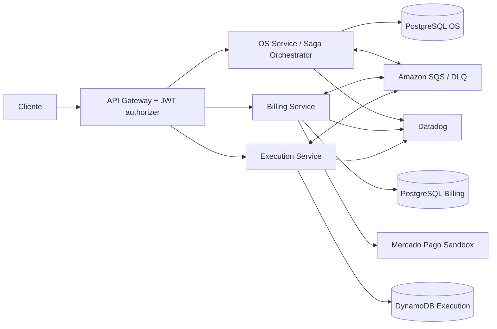

# Plano de implementação — FIAP Tech Challenge Fase 4

> Estado: planejamento versionado. Não representa implementação ou evidência de aprovação.

## Critérios oficiais
- Três microsserviços independentes com repositório, infraestrutura e banco de dados próprios: OS, Billing e Execution.
- Pelo menos um SQL e um NoSQL; proibir acesso direto ao banco de outro serviço.
- Comunicação REST quando necessária e eventos assíncronos.
- Saga com compensações, decisão arquitetural documentada e teste de falha.
- Billing integrado ao Mercado Pago.
- Unitários por serviço, cobertura >=80%, pelo menos um fluxo BDD e análise estática no CI.
- CI/CD independente (build, testes, qualidade e deploy Kubernetes), main protegida com PR e checks.
- Observabilidade distribuída, logs, dashboards e alertas.
- Vídeo público/não listado de até 15 minutos e PDF final com links, diagrama e justificativas.

## Arquitetura proposta (a validar)

## Saga proposta
1. OS recebe pedido autenticado, grava OS e estado inicial da Saga.
2. Publica evento de orçamento via outbox transacional.
3. Billing cria orçamento e aguarda aprovação; publica resultado.
4. Billing registra pagamento via Mercado Pago, valida webhook com idempotência e publica evento.
5. Execution processa fila, atualiza diagnóstico/reparo e publica conclusão.
6. OS consolida o estado e histórico. Falhas geram retentativas com backoff, DLQ e compensações explícitas, sem apagar pagamentos confirmados; estorno somente conforme API/regras do provedor.

**Decisão provisória:** Saga orquestrada no OS Service. Formalizar em ADR, incluindo estados, timeout, idempotency keys e contratos de eventos.

## Ordem de implementação
1. Auditar workflows e proteger main sem quebrar HML.
2. Evoluir OS Service e criar repositórios Billing e Execution.
3. Provisionar isolamento de bancos, filas e DLQ.
4. Implementar eventos, orquestração Saga, compensações e Mercado Pago sandbox.
5. Criar testes unitários, BDD, cobertura >=80% por serviço e quality gates.
6. Instrumentar métricas, logs, tracing, dashboards e monitores versionados.
7. Executar E2E de sucesso e falha e guardar links de workflows/prints.
8. Gravar vídeo e gerar PDF final com links reais.

## Evidências obrigatórias
| Requisito | Evidência | Estado |
|---|---|---|
| 3 serviços independentes | URLs dos repositórios e deployments | Pendente |
| SQL + NoSQL isolados | Terraform e testes de integração | Pendente |
| Saga sucesso + compensação | BDD e logs/traces | Pendente |
| Mercado Pago | integração sandbox e webhook | Pendente |
| >=80% cobertura | relatórios por serviço | Pendente |
| CI/CD e PR obrigatório | Actions e regras de proteção | Pendente |
| Observabilidade | dashboards, monitores e traces | Pendente |
| Vídeo <=15 min | URL YouTube/Vimeo | Pendente |
| PDF | arquivo final com links verificados | Pendente |

## Cuidados
- Trabalhar em branches de feature e abrir PRs; não aplicar em produção.
- Evitar criar recursos AWS pagos antes de revisar custo e configuração.
- Não inserir credenciais, tokens ou CPFs reais no repositório.
